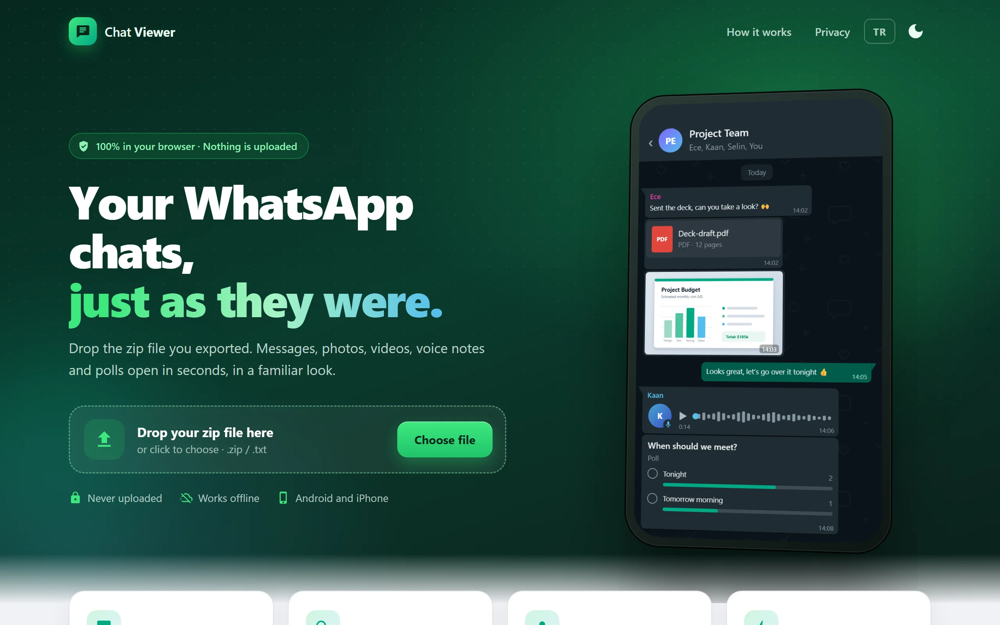
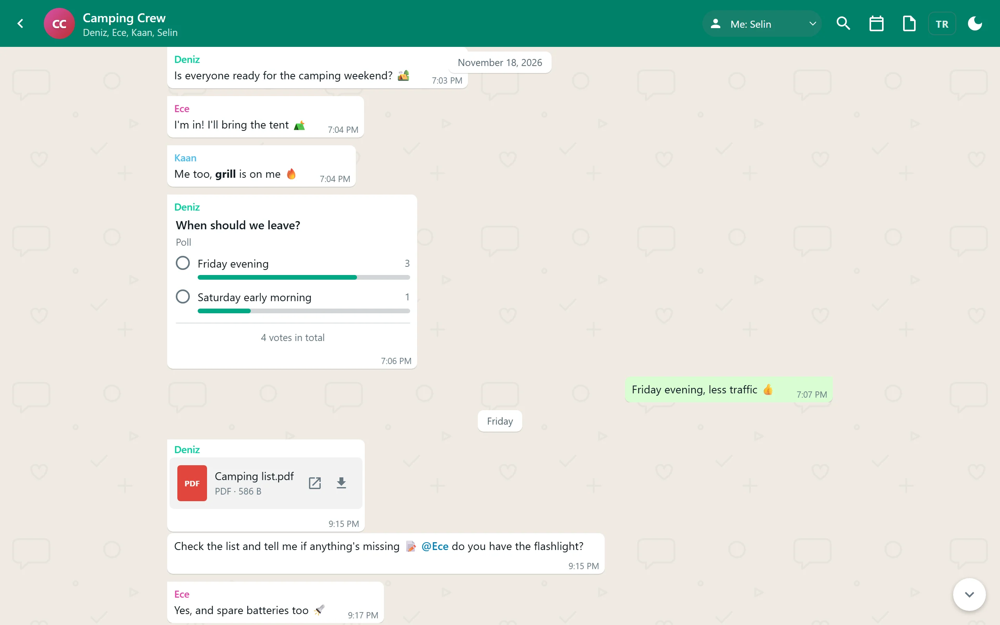
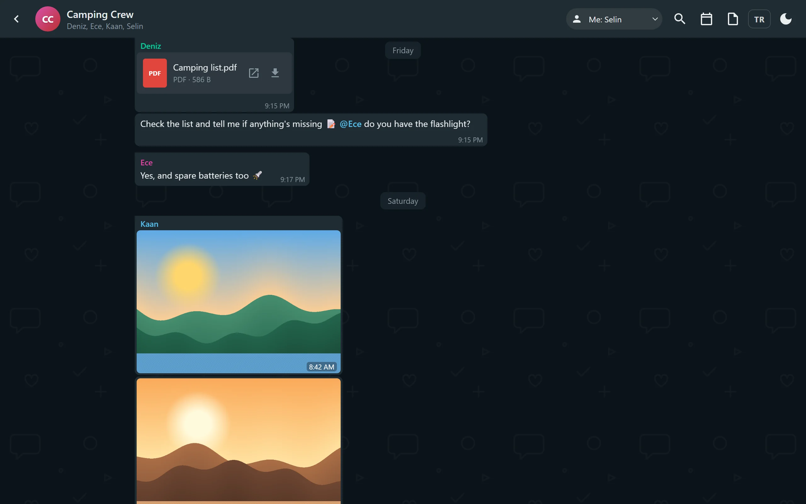
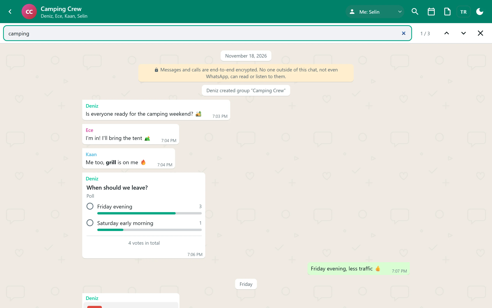
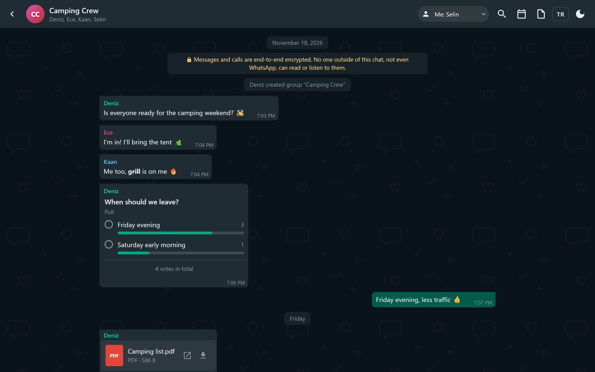
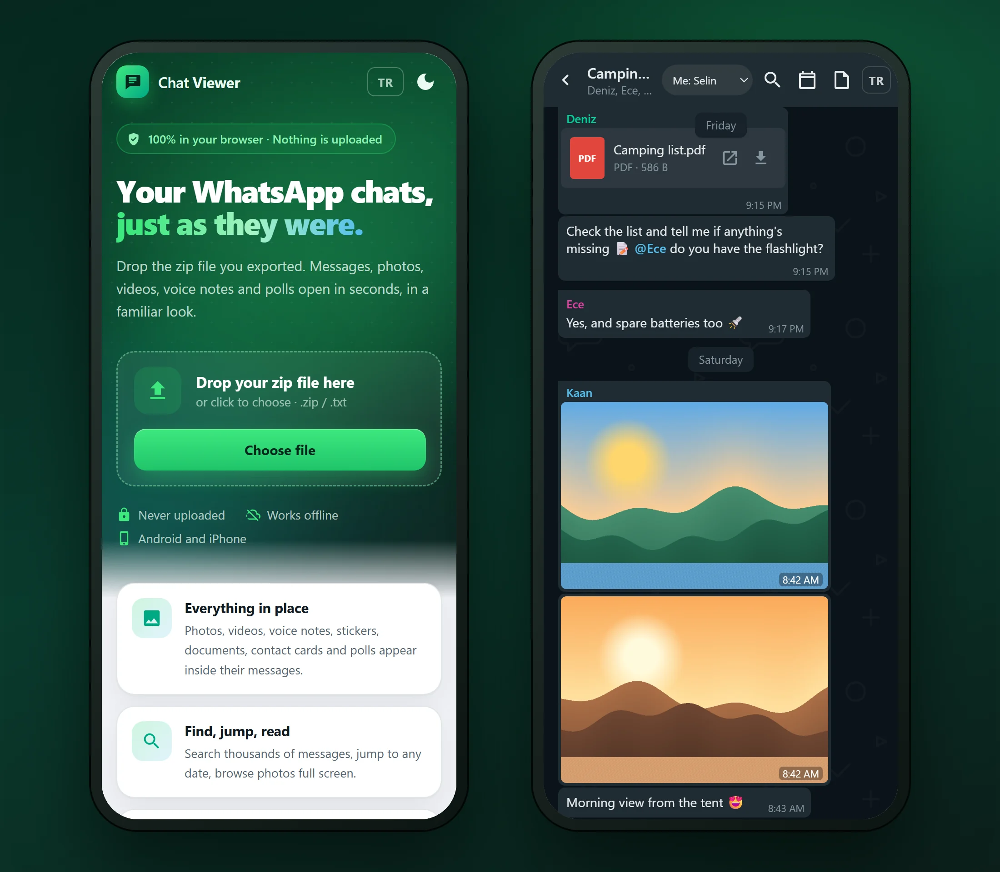

<div align="center">

# 💬 Chat Viewer

**Read your exported WhatsApp chats exactly as they looked — photos, voice notes, documents and polls included.**<br />
**Runs 100% in your browser. Nothing is ever uploaded.**


[**▶ Try it now**](https://nilayyldz.github.io/sohbet-goruntuleyici/) &nbsp;·&nbsp;
[**⬇ Download (works offline)**](https://github.com/nilayyldz/sohbet-goruntuleyici/releases/latest) &nbsp;·&nbsp;
[**🇹🇷 Türkçe**](README.tr.md)

<br />



</div>

---

## ✨ Features

| | Feature | Details |
|---|---|---|
| 🔒 | **Private by design** | Your file is opened inside your browser and never leaves your device. A strict Content-Security-Policy blocks every network request. |
| 🖼️ | **Media in place** | Photos, videos, voice notes, stickers, documents, contact cards and polls appear right inside the message they were sent in. |
| 📱 | **Android & iPhone** | Both platforms' exports in **English** and **Turkish** are detected automatically — date formats, 12/24-hour clocks and all. |
| 🔍 | **Search & navigate** | Full-text search (`Ctrl+F`), jump to any date, full-screen photo viewer with keyboard navigation. |
| 🙋 | **Your point of view** | Pick your own name and your messages move to the right, in green bubbles — just like on your phone. |
| 🌗 | **Light & dark themes** | Follows your system theme, switchable anytime. |
| 🌍 | **English & Turkish** | The interface follows your browser language; switch anytime with the **TR / EN** button. |
| ⚡ | **Fast** | One small HTML file, no install. Group chats with 60,000+ messages stay smooth. |

### ⌨️ Shortcuts

| Keys | Action |
|---|---|
| <kbd>Ctrl</kbd> + <kbd>F</kbd> | Search the chat |
| <kbd>Enter</kbd> / <kbd>Shift</kbd> + <kbd>Enter</kbd> | Next / previous result |
| <kbd>←</kbd> <kbd>→</kbd> | Browse photos in the viewer |
| <kbd>Esc</kbd> | Close search or the photo viewer |
| 📅 (toolbar) | Jump to a date |

On phones and tablets, use the 🔍 and 📅 buttons in the top bar and tap a photo to open it full screen.

## 📸 Screenshots

<table>
  <tr>
    <td width="50%"><br /><sub><b>Group chat</b> — colored names, polls, formatting</sub></td>
    <td width="50%"><br /><sub><b>Dark theme</b> — documents, @mentions, photos</sub></td>
  </tr>
  <tr>
    <td width="50%"><br /><sub><b>Search</b> — highlighted results, jump between hits</sub></td>
    <td width="50%"><br /><sub><b>Photo viewer</b> — full screen, ← / → to browse</sub></td>
  </tr>
</table>

<div align="center">
  <br />
  <sub><b>Mobile</b> — works on phones and tablets too</sub>
</div>

## 🚀 Getting Started

### 1. Export your chat from WhatsApp

| Android | iPhone |
|---|---|
| Open the chat → **⋮** → **More** → **Export chat** → **Include media** | Open the chat → tap the contact/group name → **Export Chat** → **Attach Media** |

You'll get a file named like `WhatsApp Chat - ….zip`. **No need to unzip it.**

### 2. Open the viewer

- **Online:** go to [**the live page**](https://nilayyldz.github.io/sohbet-goruntuleyici/).
- **Offline:** download `index.html` from the [latest release](https://github.com/nilayyldz/sohbet-goruntuleyici/releases/latest) and double-click it.

### 3. Drop the zip

Drag the `.zip` onto the page or click **Choose file**. Then pick your name from the **Me:** menu at the top.

## 🔐 Privacy

- **Nothing is uploaded.** The page ships with `connect-src 'none'`, so the browser itself refuses any outgoing connection — even if a bug tried.
- **Nothing is stored.** Messages and media live only in memory and are gone when you close the tab. Only your theme and "Me" choice are remembered.
- **No accounts, ads, analytics or trackers.** The whole app is a single self-contained HTML file.
- **Hardened against malicious exports** — XSS, ReDoS, zip bombs and path traversal are covered by automated security tests. See the [developer guide](docs/GELISTIRME.md#gizlilik-ve-güvenlik).

## ❓ FAQ

<details>
<summary><b>Some photos say "not included in the export". Why?</b></summary>
<br />
WhatsApp didn't put that file in the zip. It depends on the phone that made the export, not on who sent the photo: the chat may have been exported <i>without media</i>, WhatsApp only includes the <b>most recent</b> media in long chats, or the file was never downloaded on that phone.
</details>

<details>
<summary><b>Why don't I see "Forwarded" labels or quoted replies?</b></summary>
<br />
WhatsApp doesn't write this information into the exported text file. A forwarded message looks like a normal one and a reply contains only its own text, so the viewer can't show them. We don't guess, to avoid showing wrong context.
</details>

<details>
<summary><b>Voice notes don't play.</b></summary>
<br />
Voice notes are <code>.opus</code> files. Chrome, Edge and Firefox play them; on Safari you can use the download button instead.
</details>

<details>
<summary><b>Can I use it on my phone?</b></summary>
<br />
Yes — open the live page in your phone's browser and pick the zip file.
</details>

## 🛠️ For Developers

```bash
git clone https://github.com/nilayyldz/sohbet-goruntuleyici.git
cd sohbet-goruntuleyici
npm ci
npm run dev      # http://localhost:5173
npm test         # 137 tests: parser, mock round-trips, security, i18n
npm run build    # → dist/index.html (single self-contained file)
```

**Stack:** TypeScript · Vite (single-file build) · JSZip · Vitest — no UI framework.

Architecture, the seeded mock-data generator, security model and release process are documented in the
**[developer guide (Turkish)](docs/GELISTIRME.md)**.

```
src/
├── parser/     Format detection & parsing (Android/iOS, TR/EN)
├── zip/        Zip loading, chat file discovery, size limits
├── media/      Attachment ↔ file matching, blob cache, vCard
└── ui/         Chat view, media cards, polls, lightbox, formatting
tests/          Unit, mock round-trip and security tests
```

## 🤝 Contributing

Issues and pull requests are welcome. Please **never attach real chat exports** — use the mock generator in `tests/mock/` or anonymize the lines you share.

## 🙏 Acknowledgements

Thanks to **Musa Buğra Demir** ([@NightKnight-nx2](https://github.com/NightKnight-nx2)) for the idea behind this project.

## 📄 License

Released under the [MIT License](LICENSE).

<sub>This project is not affiliated with, endorsed by or sponsored by WhatsApp or Meta Platforms, Inc.</sub>
