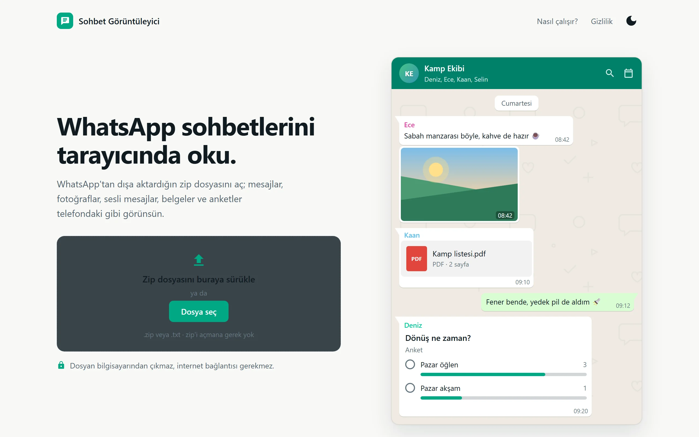
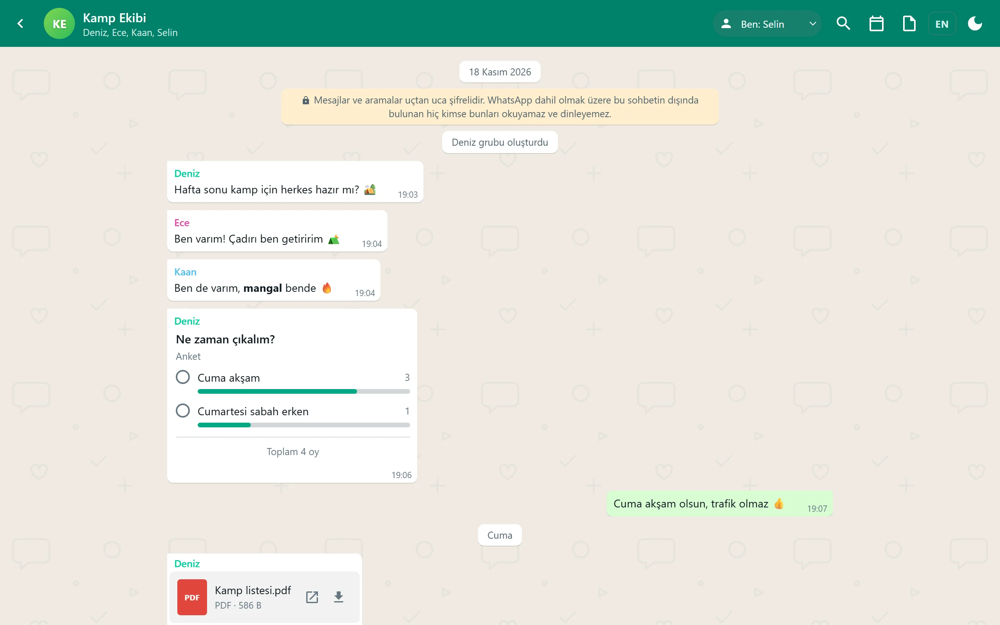
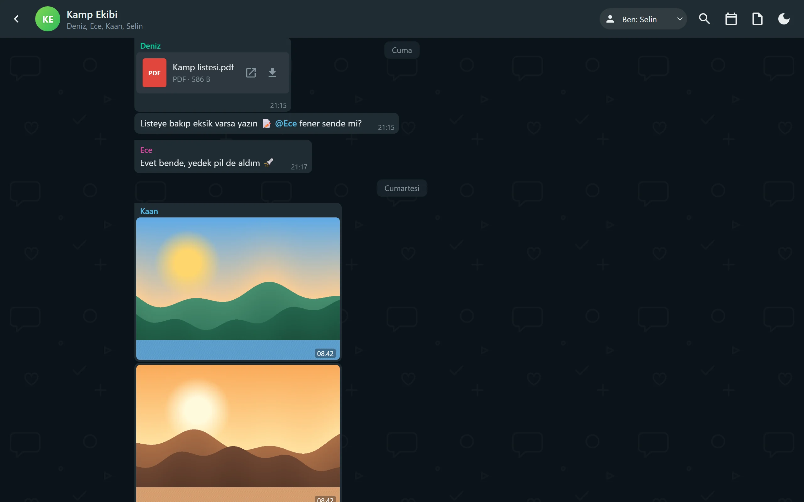
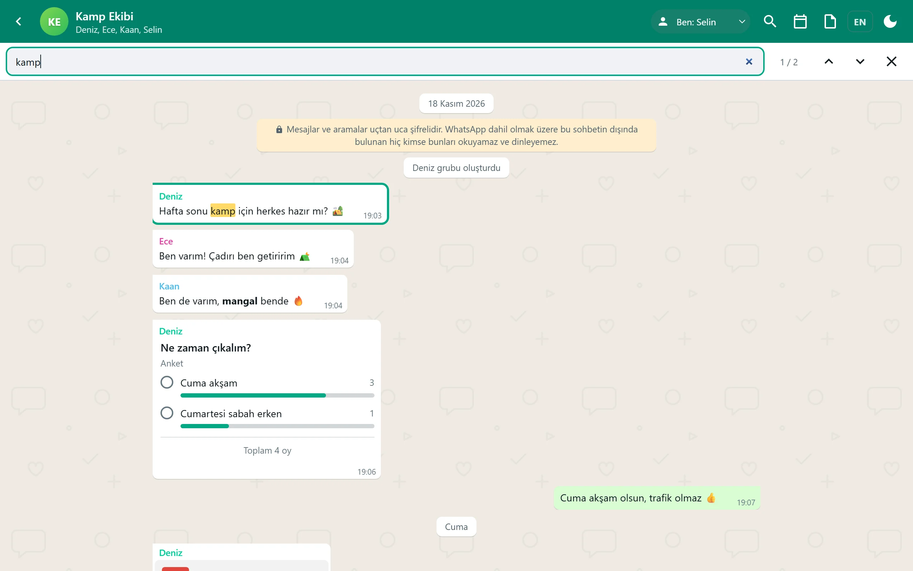
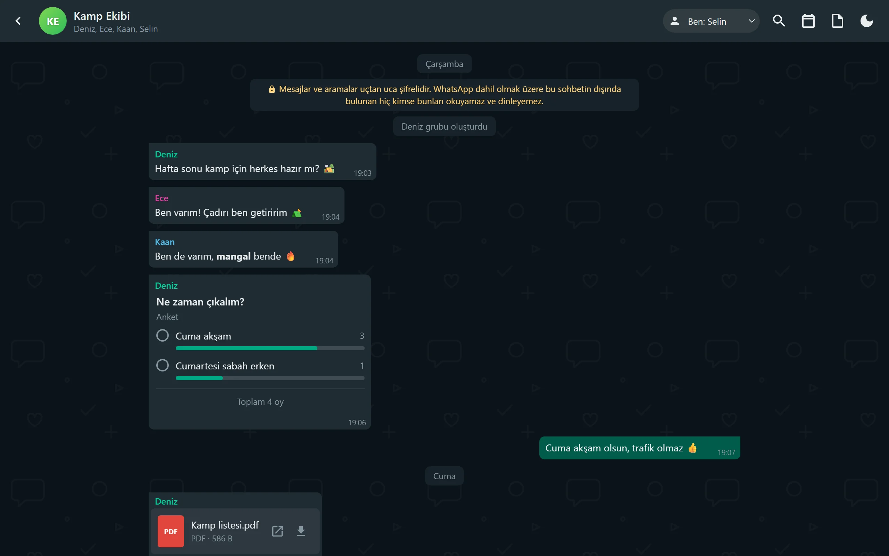
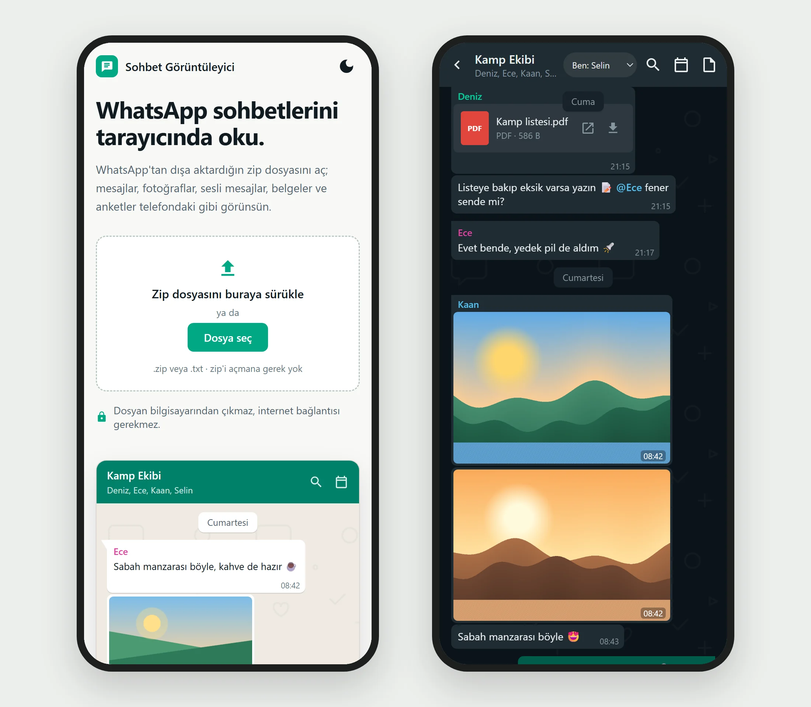

<div align="center">

# 💬 WhatsApp Sohbet Görüntüleyici

**Dışa aktardığın WhatsApp sohbetlerini olduğu gibi oku: fotoğraflar, sesli mesajlar, belgeler ve anketler dahil.**<br />
**Tamamen tarayıcında çalışır. Hiçbir şey yüklenmez.**


[**▶ Hemen kullan**](https://nilayyldz.github.io/whatsapp-sohbet-goruntuleyici/) &nbsp;·&nbsp;
[**⬇ İndir (internetsiz kullanım)**](https://github.com/nilayyldz/whatsapp-sohbet-goruntuleyici/releases/latest) &nbsp;·&nbsp;
[**🇬🇧 English**](README.md)

<br />



</div>

---

## ✨ Özellikler

| | Özellik | Ayrıntı |
|---|---|---|
| 🔒 | **Gizlilik öncelikli** | Dosyan tarayıcında açılır ve cihazından hiç çıkmaz. Katı bir güvenlik kuralı (CSP) her türlü ağ isteğini engeller. |
| 🖼️ | **Medya yerli yerinde** | Fotoğraf, video, sesli mesaj, çıkartma, belge, kişi kartı ve anketler gönderildikleri mesajın içinde görünür. |
| 📱 | **Android ve iPhone** | İki platformun **Türkçe** ve **İngilizce** dışa aktarımları otomatik tanınır; tarih biçimleri ve 12/24 saat dahil. |
| 🔍 | **Ara ve gez** | Sohbette arama (`Ctrl+F`), tarihe atlama, klavyeyle gezilebilen tam ekran fotoğraf görüntüleyici. |
| 🙋 | **Senin bakış açın** | Kendi adını seç; mesajların telefonundaki gibi sağda, yeşil baloncuklarda görünsün. |
| 🌗 | **Açık ve koyu tema** | Sistem temanı izler, istediğin zaman değiştirebilirsin. |
| ⚡ | **Hızlı** | Tek, küçük bir HTML dosyası; kurulum yok. 60 bin mesajlık gruplar bile akıcı açılır. |

### ⌨️ Kısayollar

| Tuşlar | İşlem |
|---|---|
| <kbd>Ctrl</kbd> + <kbd>F</kbd> | Sohbette ara |
| <kbd>Enter</kbd> / <kbd>Shift</kbd> + <kbd>Enter</kbd> | Sonraki / önceki sonuç |
| <kbd>←</kbd> <kbd>→</kbd> | Görüntüleyicide fotoğraflar arasında gez |
| <kbd>Esc</kbd> | Aramayı veya fotoğraf görüntüleyiciyi kapat |
| 📅 (üst çubuk) | Belirli bir tarihe git |

Telefon ve tablette üst çubuktaki 🔍 ve 📅 düğmelerini kullan, fotoğrafı tam ekran açmak için üzerine dokun.

## 📸 Ekran görüntüleri

<table>
  <tr>
    <td width="50%"><br /><sub><b>Grup sohbeti</b>: renkli adlar, anketler, biçimlendirme</sub></td>
    <td width="50%"><br /><sub><b>Koyu tema</b>: belgeler, @etiketler, fotoğraflar</sub></td>
  </tr>
  <tr>
    <td width="50%"><br /><sub><b>Arama</b>: vurgulanan sonuçlar, sonuçlar arasında geçiş</sub></td>
    <td width="50%"><br /><sub><b>Fotoğraf görüntüleyici</b>: tam ekran, ← / → ile gezinme</sub></td>
  </tr>
</table>

<div align="center">
  <br />
  <sub><b>Mobil</b>: telefon ve tablette de çalışır</sub>
</div>

## 🚀 Nasıl kullanılır?

### 1. Sohbeti WhatsApp'tan dışa aktar

| Android | iPhone |
|---|---|
| Sohbeti aç → **⋮** → **Diğer** → **Sohbeti dışa aktar** → **Medyayı ekle** | Sohbeti aç → kişi/grup adına dokun → **Sohbeti Dışa Aktar** → **Medya Ekle** |

Sonunda adı `WhatsApp Sohbeti - ….zip` gibi olan bir dosyan olur. **Zip'i açmana gerek yok.**

### 2. Görüntüleyiciyi aç

- **Çevrimiçi:** [**Hemen kullan**](https://nilayyldz.github.io/whatsapp-sohbet-goruntuleyici/) bağlantısına tıkla.
- **İnternetsiz:** [Son sürüm](https://github.com/nilayyldz/whatsapp-sohbet-goruntuleyici/releases/latest) sayfasından `index.html` dosyasını indir ve çift tıkla.

### 3. Zip'i bırak

`.zip` dosyasını sayfaya sürükle ya da **Dosya seç**'e tıkla. Ardından üstteki **Ben:** menüsünden kendi adını seç.

## 🔐 Gizlilik

- **Hiçbir şey yüklenmez.** Sayfa `connect-src 'none'` kuralıyla gelir; bir hata olsa bile tarayıcının kendisi dışarıya bağlantı kurulmasına izin vermez.
- **Hiçbir şey saklanmaz.** Mesajlar ve medya yalnızca bellekte durur, sekmeyi kapatınca silinir. Yalnızca tema ve "Ben" seçimin hatırlanır.
- **Hesap, reklam, analiz ya da izleme kodu yok.** Uygulamanın tamamı tek ve bağımsız bir HTML dosyasıdır.
- **Kötü niyetli dosyalara karşı korumalı:** XSS, ReDoS, zip bombası ve dizin gezinme saldırıları otomatik güvenlik testleriyle denetlenir. Ayrıntılar [geliştirici belgesinde](docs/GELISTIRME.md#gizlilik-ve-güvenlik).

## ❓ Sık sorulanlar

<details>
<summary><b>Bazı fotoğraflarda "dışa aktarıma dahil edilmedi" yazıyor. Neden?</b></summary>
<br />
WhatsApp o dosyayı zip'e koymamış. Bu, fotoğrafı gönderen kişiden değil, dışa aktarımı yapan telefondan kaynaklanır. Olası nedenler: sohbet <i>medya olmadan</i> dışa aktarılmış olabilir; WhatsApp uzun sohbetlerde yalnızca <b>en son</b> medyayı ekler; ya da dosya o telefona hiç indirilmemiş olabilir.
</details>

<details>
<summary><b>"İletildi" etiketi ve alıntılanan mesajlar neden görünmüyor?</b></summary>
<br />
WhatsApp bu bilgileri dışa aktarılan metin dosyasına yazmıyor. İletilen bir mesaj sıradan bir mesaj gibi görünür; alıntılı bir yanıtın da yalnızca kendi metni kaydedilir. Bu yüzden görüntüleyici bunları gösteremez. Yanlış bir bağlam göstermemek için tahmin de yapmıyoruz.
</details>

<details>
<summary><b>Sesli mesajlar çalmıyor.</b></summary>
<br />
Sesli mesajlar <code>.opus</code> biçimindedir. Chrome, Edge ve Firefox bunları çalar; Safari'de çalmazsa indirme düğmesini kullanabilirsin.
</details>

<details>
<summary><b>Telefonda kullanabilir miyim?</b></summary>
<br />
Evet. Hemen kullan bağlantısını telefonunun tarayıcısında aç ve zip dosyasını seç.
</details>

## 🛠️ Geliştiriciler için

```bash
git clone https://github.com/nilayyldz/whatsapp-sohbet-goruntuleyici.git
cd whatsapp-sohbet-goruntuleyici
npm ci
npm run dev      # http://localhost:5173
npm test         # 127 test: ayrıştırıcı, mock uçtan uca, güvenlik
npm run build    # → dist/index.html (tek, bağımsız dosya)
```

**Teknolojiler:** TypeScript · Vite (tek dosya derleme) · JSZip · Vitest. Arayüz çatısı kullanılmaz.

Mimari, tohumlu sahte veri üreticisi, güvenlik modeli ve sürüm çıkarma süreci
**[geliştirici belgesinde](docs/GELISTIRME.md)** anlatılıyor.

```
src/
├── parser/     Biçim tespiti ve ayrıştırma (Android/iOS, TR/EN)
├── zip/        Zip yükleme, sohbet dosyasını bulma, boyut sınırları
├── media/      Ek ↔ dosya eşleştirme, blob önbelleği, vCard
└── ui/         Sohbet görünümü, medya kartları, anketler, görüntüleyici
tests/          Birim, mock uçtan uca ve güvenlik testleri
```

## 🤝 Katkıda bulunma

Sorun kayıtları (issue) ve pull request'ler memnuniyetle karşılanır. Lütfen **gerçek sohbet dışa aktarımlarını asla ekleme**; `tests/mock/` altındaki sahte veri üreticisini kullan ya da paylaştığın satırları anonimleştir.

## 📄 Lisans

[MIT Lisansı](LICENSE) ile yayınlanmıştır.

<sub>Bu proje WhatsApp veya Meta Platforms, Inc. ile bağlantılı değildir; onlar tarafından onaylanmamış ve desteklenmemiştir.</sub>
